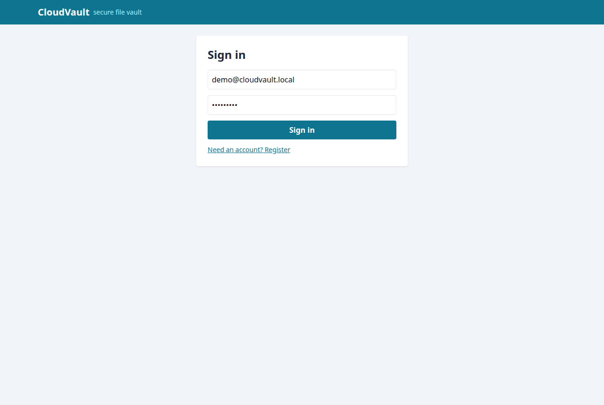
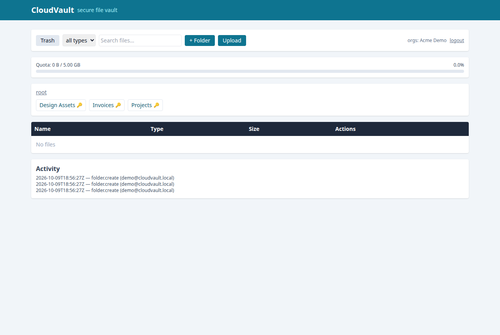
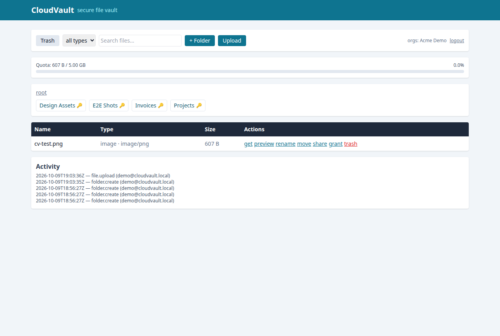
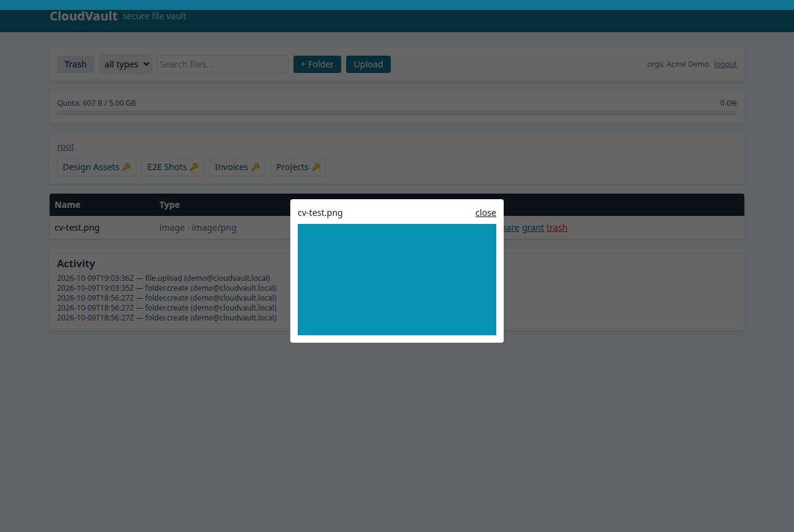
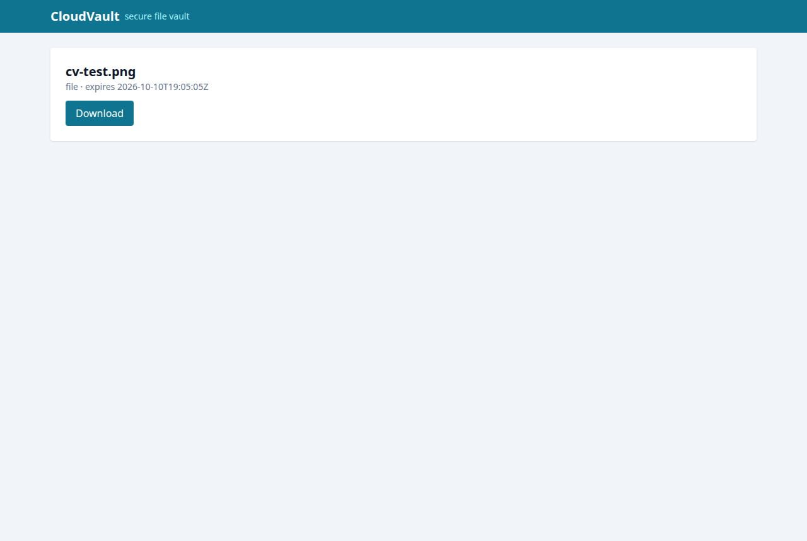

# CloudVault

Secure multi-tenant file vault — **Go (Chi + pgx)** monolith, **Postgres 16** metadata,
**S3-compatible object storage** (MinIO), and a **Next.js 15 + Tailwind** frontend.




## Features

- Auth with JWT access tokens (15 min) + rotating refresh in an httpOnly cookie; login
  returns `user`, `accessToken` and `orgs[]` (frontend persists `orgs[0].id`).
- Folders (create / rename / move / trash / restore / permanent delete).
- Uploads two ways: small files proxied as multipart (≤ 15 MiB) and large files via
  **short-lived presigned PUT URLs** (15 min) + `POST /files/complete`.
- Downloads/previews via **short-lived presigned GET URLs** (5 min); inline preview for
  images and PDFs.
- Trash + restoration, search by name, filter by kind (`image|video|audio|pdf|doc|other`).
- Expiring public share links (`GET /s/:token`, max 168 h, `410 Gone` after expiry).
- Per-file / per-folder permissions (`viewer|editor`) with folder-read inheritance.
- Activity feed, per-org quota (default 5 GiB) with progress bar.
- Hard security: server-generated object keys (`<org>/<uuid>-<safe>`), anti
  path-traversal name validation, per-object authorization, MIME allowlist, size caps,
  all SQL parameterized, bcrypt passwords.





## Stack & ports

| Service | Tech | Host port (env override) |
|---|---|---|
| API | Go 1.27, Chi, pgx, MinIO client | `8087` (`API_PORT`) |
| Web | Next.js 15, TS, Tailwind | `3007` (`WEB_PORT`) |
| DB | Postgres 16 | `5440` (`DB_PORT`) |
| Storage | MinIO (S3 API) | `9000` (`MINIO_PORT`), console `9001` |

## Quickstart

```bash
cp .env.example .env   # adjust ports/secrets as needed
docker compose up --build
```

- Web: http://localhost:3007 · API: http://localhost:8087/healthz
- OpenAPI: `openapi.yaml` and live `GET /openapi.yaml`
- Demo login (seeded): `demo@cloudvault.local` / `Demo1234!`

Local backend dev (needs Postgres + an S3 endpoint):

```bash
go run ./cmd/api   # PORT, DATABASE_URL, JWT_SECRET, MINIO_ENDPOINT, ...
```

Local frontend dev:

```bash
cd web && npm install && npm run dev   # NEXT_PUBLIC_API_URL=http://localhost:8087
```

> **Storage note.** `docker-compose.yml` provisions real **MinIO**. In sandboxed
> networks where the MinIO image cannot be pulled, any S3-compatible endpoint works:
> set `MINIO_ENDPOINT` (e.g. S3Mock on `localhost:9090`) — the presigned up/down
> flow is identical over the S3 API. This repo was verified end-to-end (upload →
> download byte-identical, shares, trash, permissions) against an S3-compatible
> backend plus integration tests.

## API sketch

All tenant routes require `Authorization: Bearer <access>` + `X-Org-ID` header;
responses are `{data: …}`, errors `{error: {code, message}}`.

```
POST /api/v1/auth/register|login|refresh|logout
GET  /api/v1/me
GET|POST /api/v1/folders  PATCH|DELETE /api/v1/folders/{id}  POST /.../restore
GET|PUT  /api/v1/folders/{id}/permissions   POST /api/v1/folders/{id}/shares
GET  /api/v1/files?q=&type=&folderId=&trash=
POST /api/v1/files/presign  POST /api/v1/files/complete  POST /api/v1/files/upload
GET|PATCH|DELETE /api/v1/files/{id}  POST /api/v1/files/{id}/restore
GET  /api/v1/files/{id}/download  GET /api/v1/files/{id}/preview
GET|PUT /api/v1/files/{id}/permissions  POST /api/v1/files/{id}/shares
GET  /api/v1/s/{token}  GET /api/v1/s/{token}/download   (public, expiring)
GET  /api/v1/activities  GET /api/v1/members  GET /api/v1/quota
```

## Tests

```bash
go vet ./... && go test ./...        # unit + integration (needs DB + S3, see CI)
cd web && npx tsc --noEmit && npm run build
```

Integration tests cover: cross-org access → 403, path-traversal names/keys refused,
share expiry → 410, and a full upload→download byte-identical round-trip.
CI (`.github/workflows/ci.yml`) runs backend tests against Postgres + MinIO services
and the frontend typecheck + build.

## Security posture (OWASP self-review)

- **A01**: every query org-scoped; object grants enforced server-side; CORS reflects
  `Origin` for cookie flows (documented, no wildcard+credentials).
- **A02**: bcrypt, short-lived JWT, httpOnly refresh cookie; no prod secrets in repo.
- **A03**: parameterized SQL only; names/keys strictly validated; uploads never
  executed; previews render via ``/`<iframe>` of storage URLs.
- **A05/A07**: generic error messages; known limits — no rate limiting or MFA yet
  (see issues); default 8-char password minimum.
- **A09**: append-only activity log + JSON structured logs.

## Layout

```
cmd/api            entrypoint (graceful shutdown, healthcheck)
internal/{auth,config,db,handlers,httpx,storage,validate}
migrations/        versioned SQL (idempotent)
web/               Next.js app (drive, login, public share)
docs/              ARCHITECTURE.md + screenshots
```

## License

MIT — see [LICENSE](LICENSE).
